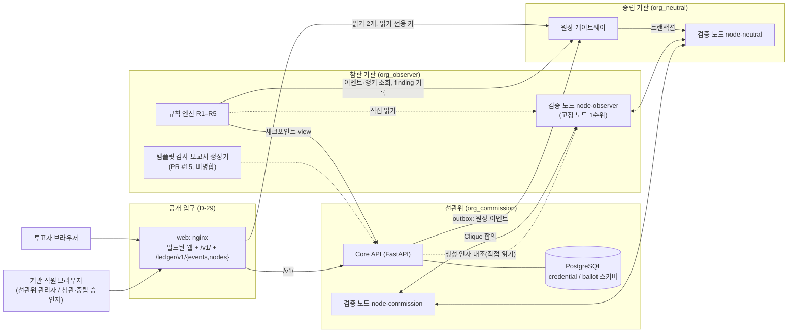

# PureVoting 2.0 설계안

> 기준일 2026-11-24 · 기준 커밋 `18ca1bf`(main) · 계약 `contracts/` v1.2.6 · 범위 결정 D-31 반영(2026-11-27)
>
> 이 문서는 그동안의 작업을 따라오지 않은 분이 프로젝트 전체를 한 번에 파악할 수 있도록 쓴 요약입니다.
> 세부 규칙의 기준은 `contracts/`(인터페이스), `docs/decisions.md`(결정 D-01–D-31), `docs/threat-model.md`(위협 모델)이며,
> 이 문서와 다르면 그쪽이 맞습니다. "구현됨"이라고 쓴 항목은 2026-11-24에 코드에서 확인한 것이고,
> 확인하지 못한 것은 **(미확인)** 으로 표시했습니다. 실행 방법은 `docs/deployment.ko.md`에 있습니다.

## 목차

1. 목적과 범위
2. 전체 구성
3. 핵심 흐름
4. 보안과 표의 비밀
5. 주요 설계 결정 요약
6. 구현 현황
7. 시험과 검증 결과
8. 남은 일정과 과제

---

## 1. 목적과 범위

### 1.1 풀려는 문제

기존 온라인 투표는 서버를 운영하는 한 기관을 전부 믿어야 합니다. 운영자가 명단을 고치거나 표를 바꾸거나 집계를 다르게 발표해도
밖에서는 알 방법이 없고, 운영자는 개표 전에도 표를 열어 볼 수 있습니다.

PureVoting 2.0은 **일회용 링크로 투표하는 온라인 투표 시스템**에 다음 세 가지를 더합니다.

| 장치 | 하는 일 |
|---|---|
| 다기관 감사 원장 | 선거의 모든 중요한 기록(상태 변경, 명단·토큰 집합의 해시, 투표 이벤트 묶음의 머클 루트, 체크포인트, 개표 결과)을 세 기관이 노드를 하나씩 운영하는 사설 블록체인에 남깁니다. 표 자체는 체인에 올리지 않습니다. |
| 규칙 우선 감사 | 규칙 엔진이 체크포인트마다 서버 데이터와 원장 증거를 대조해 R1–R5를 판정하고, 결과(finding)를 서명해 원장에 등록합니다. 판정은 규칙이 하고, 보고서 생성기는 근거를 정리해 설명만 합니다. |
| 세 기관 공동 복호화 | 표를 세 기관 키의 합으로 암호화합니다. 통째의 개인키는 어디에도 없고, 마감 뒤 세 기관이 각자 조각을 내야 **후보별 합계만** 열립니다(D-30). |

블록체인은 표를 처리하거나 집계하는 곳이 아니라, **기록을 나중에 몰래 고칠 수 없게 증거를 남기고 상태 전이·확정 조건을 검사하는 곳**입니다.

### 1.2 범위

| 구분 | 내용 |
|---|---|
| 구현 범위(D-01) | 단일 선택(1인 1표, 후보 1명) 방식의 정상 경로 하나와 결함 주입 시나리오 |
| 필수 시험 | T01(정상), T02(링크 재사용), T04(기간 밖 투표), T05(승인 없는 명단 변경), T08(DB 표 변조), T15(집계 조작) |
| 필수 기능 | 정상 투표, 규칙 R1–R5 |
| 범위에서 제외(D-31) | 기관 서명을 거치는 명단 정정(`ROSTER_AMEND`)·선거 무효(`ELECTION_VOID`), finding 서명 검토와 그에 따른 확정 정족수 |
| 만들지 않음(D-28) | 투표 기간 변경, 승인을 거치는 조기 마감, 링크 재발급, 기관의 체인 직접 제출 경로, 선택 시험(T03·T06·T07·T09–T14·T16) |
| 범위 밖 | 복수 선택·순위 투표, 블라인드 서명, 클라우드 호스팅, 다른 PC에서의 재현 시험(T14) |
| 비용 | 0원. 유료 API·유료 호스팅을 쓰지 않습니다(D-15, D-29). |

### 1.3 MVP의 한계(먼저 밝혀 둘 것)

- **시연은 한 사람이 한 PC에서 세 기관의 노드·키·서비스를 모두 운영합니다.** 독립된 다기관 운영이라고 주장하지 않습니다(D-21, D-03).
- 선관위가 Core와 DB를 운영합니다. 표의 내용은 D-30으로 가렸지만, 누가 투표했는지와 링크–투표권의 연결 가능성은 남습니다(4절).
- 강요·매수 방지(영수증 없는 투표), 대리 투표 방지, 종단간 검증은 제공하지 않습니다.
- Core 내부자가 기권자 몫의 표를 원장 기록까지 맞춰 끼워 넣는 것은 탐지하지 못합니다(위협 모델 E4).
- FAIL이 난 선거는 확정되지 않은 채 남습니다(D-31). FAIL을 풀거나 선거를 무효로 할 방법이 이번 버전에는 없습니다.

---

## 2. 전체 구성

### 2.1 구성도



스마트 계약 `PureVotingLedger`는 세 검증 노드가 이루는 체인 위에 하나 배포됩니다.

### 2.2 구성 요소

| 구성 요소 | 위치 | 하는 일 | 운영 기관(시연) |
|---|---|---|---|
| 투표자 웹 | `web/src/voter/` | 링크의 토큰 읽기, **브라우저에서 투표권 생성**, 표 암호화·제출, 영수증 확인 | 선관위가 제공 |
| 관리자·기관 웹 | `web/src/admin/` | 선거 생성, 명단, 링크 발급, 현황(상태·finding·경보), 개표·확정, **기관별 복호화 화면**, 노드 상태 | 선관위가 제공, 각 기관 계정으로 로그인 |
| 공개 입구 | `web/nginx.conf` | 유일한 외부 입구. 웹 + Core `/v1/` + 게이트웨이 읽기 경로 2개만 통과, 요청 수 제한, 요청 로그 없음 | 선관위 |
| Core API | `core/app/` | 선거 상태 머신, 명단·토큰, redeem·투표 접수, outbox, 체크포인트, view, 암호문 합산·개표, finding 본문 보관 | 선관위 |
| DB | `core/db/` | PostgreSQL 1개, 스키마 2개(`credential`, `ballot`)를 서로 다른 권한으로 소유(D-06) | 선관위 |
| 원장 게이트웨이 | `ledger/gateway/` | 원장 이벤트 검증·기록, 투표 이벤트 배치의 머클 앵커, 거부 기록, finding 기록 중계, 조회 API | 중립 기관(D-26) |
| 사설 체인 | `docker-compose.integration.yml` | PureChain(`purechain-geth` `1.13.15-purechain-1.0.1`, go-ethereum 기반 EVM) 검증 노드 3개, **Clique** 합의, 블록 주기 1초, chain id 기본 424242 | 기관마다 1개(D-03) |
| 스마트 계약 | `ledger/contracts/PureVotingLedger.sol` | 기관 레지스트리, 선거 상태 전이, 체크포인트별 상태, 앵커, 개표·확정 조건, finding 기록 | 체인 |
| 규칙 엔진 | `rules/purevoting_rules/` | 체크포인트마다 R1–R5 판정, finding 서명·등록, 고정 노드 직접 조회 | 참관 기관(D-25) |
| 템플릿 감사 보고서 생성기 | PR #15 | FAIL/INCONCLUSIVE finding의 근거를 읽기 전용으로 모아 보고서 파일 작성(AI 아님, `model.provider = "none"`) | 참관 기관 |

> 참고: 체인은 Hyperledger Besu가 아닙니다. D-02에서 Besu(QBFT)는 선택지 A였고, 확정된 것은 선택지 C인 기존 PureChain(go-ethereum 계열, Clique)입니다.

### 2.3 세 기관의 역할

| 기관 | 운영하는 것 | 권한 |
|---|---|---|
| 선관위 `org_commission` | Core, DB, 웹, 검증 노드 1개 | 운영 기관(`operator_org`). 선거 생성·명단·링크 발급·개표·확정, 복호화 조각 제출 |
| 참관 기관 `org_observer` | 규칙 엔진, 보고서 생성기, 검증 노드 1개(Core와 규칙 엔진이 직접 읽는 **고정 노드** 1순위) | 복호화 조각 제출 |
| 중립 기관 `org_neutral` | 원장 게이트웨이, 검증 노드 1개 | 복호화 조각 제출, 노드 상태 확인 |

- 기관 서명키, 운영 기관, 게이트웨이 계정, 규칙 엔진 서명키는 **체인의 레지스트리**에 각 기관 노드 계정이 직접 등록하고 모든 기관이 확인해야 유효합니다(D-21). 선관위가 다른 기관의 키를 정할 수 없습니다.
- 관리 행위 승인과 finding 서명 검토는 이번 버전 범위에서 제외했습니다(D-31).
- 권한이 한 기관에 몰리지 않도록 나눴습니다. 규칙 엔진은 자기가 감사하는 게이트웨이의 운영 기관이 아니고, Core와 규칙 엔진은 게이트웨이가 알려 주는 값이 아니라 다른 기관의 노드를 직접 읽습니다.

### 2.4 데이터가 저장되는 곳

| 위치 | 저장되는 것 | 저장되지 않는 것 |
|---|---|---|
| Core DB | 명단(개인정보), 토큰 해시, 투표권 해시, 암호화된 표, 영수증 해시, 체크포인트, finding 본문 | 토큰·투표권 원문, 토큰과 투표권을 잇는 키, 복호화 비밀값 |
| 원장 게이트웨이 | 원장 이벤트 본문(해시, 시간 구간, 개수, 가명 `voter_key`, 개표 결과) | 이름, 암호화된 표 |
| 체인 | 선거 상태, 해시와 머클 루트, 체크포인트별 상태, finding 기록(서명 포함), 레지스트리 | 표, 개별 투표 이벤트 |
| 각 기관 | 자기 복호화 열쇠 파일, 자기 서명키 | — |

해시는 RFC 8785 정규화 뒤 SHA-256이고(`contracts/hashing.md`), 모든 모듈이 같은 벡터(`tests/vectors/`)를 재현해야 합니다.

---

## 3. 핵심 흐름

### 3.1 선거 상태

```
DRAFT ─명단 고정→ ROSTER_FROZEN ─시작 시각→ OPEN ─종료 시각 / 전원 투표→ CLOSED ─개표→ TALLIED ─확정→ FINALIZED
```

- 무효 처리(`ELECTION_VOID` → `VOIDED`)는 이번 버전 범위에서 제외했습니다(D-31). 진행할 수 없게 된 선거는 그 상태로 남습니다.
- **엄격 전이**(명단 고정, 마감)는 Core가 즉시 적용하고, 원장이 거부해도 되돌리지 않고 경보를 냅니다.
- **허용 전이**(개시, 확정)는 원장이 수락(ACCEPTED)한 뒤에만 적용합니다(D-12).

### 3.2 선거 생성 · 명단 · 링크 발급

1. 선관위 관리자가 웹에서 선거를 만듭니다. Core가 `ELECTION_CREATED`를 보내고 게이트웨이가 계약에 기록합니다.
   선거 공개키는 등록된 세 기관 공개키의 합이며, 그 해시(`public_key_hash`)가 체인에 고정됩니다.
2. **생성 인자 대조**: Core가 고정 노드를 직접 읽어 계약에 들어간 참여 기관·임계값·기간 등이 자기가 보낸 값과 같은지 확인합니다. 통과해야 다음 단계로 갑니다(D-26).
3. 명단을 올리고 고정합니다(`ROSTER_FROZEN`, 명단 해시 기록).
4. 링크를 발급합니다. 토큰 원문은 한 번 내려받는 CSV(와 설정돼 있으면 메일, D-16)로만 나가고 서버에는 해시만 남습니다.
   링크 형식은 `<VOTER_WEB_URL>/vote/<election_id>#t=<token>`으로, 토큰은 URL fragment라서 서버 요청에 실리지 않습니다.

### 3.3 링크 사용(redeem)과 투표

```
투표자 브라우저: 투표권(credential) = 난수 생성 → 브라우저에 보관
  ── redeem(token, H(credential)) ──→ Core: 토큰 USED 처리 + 투표권 해시 등록 (한 트랜잭션, 서로 다른 스키마)
투표자 브라우저: 후보마다 0/1 ElGamal 암호문 + 유효성 증명 생성
  ── ballot(credential, 암호화된 표) ──→ Core: 증명 검사 → 저장 → 영수증(RECEIVED)
```

- 서버는 투표권 원문을 저장하지 않고, 토큰과 투표권을 잇는 열(column)도 없습니다(D-07).
- 표는 후보별 0 또는 1의 암호문이며, "각 값이 0 또는 1"과 "합이 1"이라는 증명이 붙습니다. 증명은 선거와 `H(credential)`에 묶여 있어 다른 투표권으로 복사한 표는 거부됩니다(`contracts/ballot-elgamal.md`).
- 사용된 링크는 어떤 경우에도 다시 쓸 수 없습니다(D-09). 두 번째 시도는 409로 거부되고 `rejected_attempts`에 남습니다.

### 3.4 outbox · 앵커 · 체크포인트

- Core는 DB 변경과 outbox 기록을 한 트랜잭션으로 처리하고, 워커가 같은 `event_id`로 게이트웨이에 재시도합니다.
- **투표 쪽 이벤트**(`TOKEN_USED`, `BALLOT_RECEIVED`)는 시각을 시간 구간으로 내림하고, 무작위 ID를 쓰고, 구간이 끝난 뒤 순서를 섞어 보냅니다(D-10).
  게이트웨이는 60초 또는 50건 단위 묶음의 **머클 루트만** 체인에 기록(앵커)합니다(D-04). 영수증은 앵커되면 `ANCHORED`가 됩니다.
- 개별 투표 이벤트의 기간·중복 검사는 게이트웨이 소프트웨어가 하고, 계약은 묶음의 시간 범위와 시스템 이벤트를 검사합니다(D-22).
- **체크포인트**는 감사의 기준점입니다. 시간 구간의 정수배 주기, 상태 변경 시, 마감 직후(`CLOSE_FINAL`), 개표 시(`TALLY`)에
  6개 테이블(`roster`, `token_status`, `credential_issuance`, `ballot_receipts`, `admin_actions`, `rejected_attempts`)의 스냅샷 해시와 개수를 원장에 남깁니다(D-14).
  view는 항상 "체크포인트 k 기준"으로 읽고, 같은 k는 언제 읽어도 같은 결과여야 합니다.
- 체인 정보는 블록 위에 D개(기본 2) 이상 쌓인 뒤에만 인정합니다(D-27).

### 3.5 규칙 엔진 R1–R5

체크포인트가 원장에 반영되고 그때까지의 이벤트가 앵커되면 규칙 엔진이 다섯 규칙을 실행하고, 결과를 서명해 게이트웨이를 거쳐 계약에 기록한 뒤 본문을 Core에 저장합니다.
Core는 finding을 숨기거나 바꿀 수 없습니다(본문 해시가 체인 기록과 같아야 저장됨, D-24).

| 규칙 | 검사 내용 | 대표 시험 |
|---|---|---|
| R1 중복·상태 | 같은 토큰·투표권의 중복 수락, 모르는 토큰, 폐기 후 사용 | T02 |
| R2 시간 | 실효 투표 기간 밖에서 수락된 이벤트, 원장이 거부한 기간 밖 이벤트 | T04 |
| R3 개수 | 명단·토큰·투표권·표 개수 관계, view와 원장의 개수 일치, 개표 수 | T04, T15 |
| R4 관리 행위 | 승인 없는 변경, 서명 위조, 중복 실행, 승인 대상과 실행 결과 불일치, 전원 투표 마감 조건 | T05 |
| R5 무결성 | 지난 체크포인트 스냅샷 재계산, 행 단위 원장 대조, 앵커 루트, 계약 상태 대조, 개표의 증명·합계·복호화 조각 검증 | T05, T08, T15 |

- 결과는 PASS / FAIL / INCONCLUSIVE입니다. 원장 지연이나 노드 불통이면 finding 대신 경보(`AUDIT_DELAYED` 등)를 남기거나 INCONCLUSIVE를 내고, 같은 규칙의 이후 PASS가 이를 대체합니다. FAIL은 대체되지 않습니다.
- 규칙 엔진은 DB에 접근하지 않습니다. 개인정보가 없는 Core view와 게이트웨이 조회 API, 고정 노드만 읽습니다(D-13).

### 3.6 마감 → 세 기관의 브라우저 복호화(D-30)

1. 종료 시각이 되면(또는 모든 유권자가 투표해 관리자가 마감하면, 결정 v1.5) Core가 접수를 멈추고 `CLOSE_FINAL` 체크포인트를 커밋합니다.
2. Core가 원장에서 수락된 유효한 표를 **암호문인 채로** 후보별로 더합니다.
3. 각 기관 직원이 자기 계정으로 웹에 로그인해 "우리 기관 복호화" 카드에서 열쇠 파일을 고릅니다. 브라우저 안에서 다음이 실행됩니다(`web/src/crypto/trusteeCheck.ts`).
   - 열쇠 파일은 브라우저에서만 읽고 **서버로 올리지 않습니다.** 파일 안의 공개 기록이 선거의 기관 열쇠 목록에 있는지 확인합니다(다른 기관의 파일은 화면에서 거부).
   - Core의 개표 대상 목록(`tally-input`)을 **원장 게이트웨이에 수락된 `BALLOT_RECEIVED` 집합과 대조**합니다(공개 입구의 `/ledger/v1/events`, 읽기 전용 키).
   - 모든 표의 증명을 다시 검사하고 합계를 직접 다시 계산합니다.
   - 전부 맞을 때만 증명이 붙은 복호화 조각을 보냅니다. 한 선거에 합계 하나에만 조각을 냅니다.
4. 같은 검사를 하는 명령줄 도구(`python -m app.scripts.trustee decrypt`)도 있습니다. 시연 보조 스크립트 `tools/trustees.sh`가 이를 세 기관 몫으로 묶어 실행합니다.

### 3.7 개표와 결과 확정

1. 세 조각이 모이면 선관위 관리자가 개표를 실행합니다. Core가 조각을 합쳐 후보별 득표수를 구하고 `TALLY_PUBLISHED`(`result_hash`, `ballot_set_root`, `final_checkpoint`)를 보냅니다.
   계약은 `final_checkpoint`가 `CLOSE_FINAL` 체크포인트와 같지 않으면 거부합니다(`InvalidFinalCheckpoint`).
2. `TALLY` 체크포인트가 커밋되고 규칙 엔진이 그 체크포인트에서 R1–R5를 실행합니다. R5는 공개된 조각과 증명으로 결과를 다시 계산해 맞춰 봅니다.
3. 관리자가 확정을 요청하면 계약이 직접 확인합니다: `TALLY` 체크포인트의 R1–R5 finding이 모두 기록돼 있고, 선거 전체에 대체되지 않은 FAIL/INCONCLUSIVE가 없고, 결과 해시가 개표 때와 같아야 합니다. 통과하면 `FINALIZED`입니다.
4. INCONCLUSIVE는 같은 규칙의 이후 PASS로 대체되면 풀립니다. FAIL은 풀 방법이 없어 그 선거는 `TALLIED`로 남습니다. 기관 서명 검토와 무효 처리는 범위에서 제외했습니다(D-31).

---

## 4. 보안과 표의 비밀

전체 목록은 `docs/threat-model.md`에 있습니다. 여기서는 중요한 것만 정리합니다.

### 4.1 무엇으로 무엇을 막는가

| 위협 | 대응 | 남는 한계 |
|---|---|---|
| 선관위가 개표 전에 표를 열어 봄(S3) | D-30: 통째의 개인키가 없고, 세 기관이 조각을 내야 합계만 열림. Core의 `private_key` 칸은 비어 있음 | 열쇠를 가진 사람이 서로 달라야 효과가 있음. 시연은 한 사람이 세 열쇠를 모두 보관 |
| 시각으로 투표자와 표를 연결(S1) | 시간 구간, 무작위 ID, 순서 섞기, 배치 앵커, 입구에 요청 로그 없음 | 구간당 투표자가 적으면 연결될 수 있음. 구간 크기 기준은 v1.4부터 강제하지 않음 |
| 저장된 데이터로 연결(S2) | 스키마 분리, 잇는 키 없음, 브라우저 생성 투표권, 해시만 저장 | redeem이 한 트랜잭션이라 **DB 최고 관리자는 트랜잭션 메타데이터로 연결 가능**(공개한 한계) |
| 링크 재사용·이중 투표(E1–E3) | redeem 원자 처리, 재활성화 기능 자체가 없음, 게이트웨이 중복 거부, R1 | 링크 사용 뒤 투표권을 잃으면 기권 처리 |
| DB의 표·명단 사후 변조(I1·I2) | 체크포인트 스냅샷 해시, 행 단위 원장 대조, 암호문 해시 검사(R5), 명단 연쇄 검사(R4) | 아직 커밋되지 않은 열린 체크포인트 안의 변경은 탐지가 어려움 |
| 집계 조작(I6) | `ballot_set_root`, `final_checkpoint` = `CLOSE_FINAL`(계약), 조각·증명 재검증(R3/R5), 기관 브라우저의 원장 대조 | 선관위와 게이트웨이 운영 기관이 짜지 않는다는 전제 |
| 게이트웨이 운영자의 위조(I11·I12) | finding은 규칙 엔진 키로 서명되고 계약이 검증. 계약 주소·고정 노드는 배포 설정에 고정. Core가 원장 이벤트를 outbox와 대조 | 전달 지연·차단은 탐지만 함. Core 시스템 이벤트에는 Core 서명이 없음 |
| 공개 주소를 통한 공격(P1) | 입구는 nginx 하나, 내부 경로·API 문서 404, 경로 속임수 400, 사이트 전체 요청 수 제한 | Core 자체의 클라이언트별 제한은 미구현. 외부의 로그인 시도가 직원 로그인을 막을 수 있음(대응: Funnel 끄기) |
| 우발적 포크(I15) | 확정 깊이 D = 2 | 검증 노드 3개 중 2개를 가진 쪽은 체인을 다시 쓸 수 있음(사후 탐지만) |

### 4.2 솔직하게 밝히는 한계

- **선관위가 Core를 운영합니다.** 선관위는 명단(개인정보)과 DB를 갖고 있어 누가 투표했는지 알 수 있고(S5), DB 내부 정보로 링크와 투표권을 연결할 수 있습니다(S2). D-30이 가리는 것은 표의 **내용**이며, 그것도 세 열쇠가 실제로 다른 사람에게 있을 때만입니다.
- **기관 웹 복호화는 불러온 페이지를 믿어야 합니다.** 웹을 제공하는 쪽(시연에서는 선관위 PC)이 열쇠 파일을 빼돌리는 페이지를 줄 수 있습니다. 제대로 나누려면 기관마다 웹을 직접 제공·고정하거나 명령줄 도구를 써야 합니다.
- 웹의 "한 선거에 합계 하나" 기록은 그 브라우저의 localStorage에만 있습니다. 다른 브라우저나 시크릿 창이면 사라집니다.
- 증명(0/1, 합, 복호화 조각)은 직접 구현했고 **외부 감사를 받지 않았습니다.** 군 연산만 libsodium을 씁니다.
- CSV를 내려받은 관리자는 대리 투표를 할 수 있습니다(S4). 영수증 없는 투표가 아니므로 매수·강요를 막지 못합니다(S6).
- Core 내부자가 기권자의 토큰으로 표를 넣으면 개수가 모두 맞아 R1–R5가 잡지 못합니다(E4).
- 키 교체 절차가 없습니다(K1). 기관 한 곳이 복호화 조각을 내지 않으면 개표가 멈춥니다.
- FAIL이 난 선거는 확정되지 않은 채 남습니다(D-31). 무효 처리도 없으므로 그 선거는 `TALLIED`로 남습니다.

### 4.3 하지 않는 주장

운영자·DB 관리자에 대한 완전한 익명성 · 영수증 없는 투표나 강요 방지 · 대리 투표 방지 · Core 내부자의 표 끼워 넣기 탐지 · 종단간 검증 ·
독립된 다기관 운영 · "스마트 계약이 늦은 표를 하나하나 거부한다"(위협 모델 "Claims we must NOT make in the MVP").

---

## 5. 주요 설계 결정 요약

전체와 근거는 `docs/decisions.md`(영어, 기준)와 `docs/decisions.ko.md`에 있습니다.

| ID | 결정 | 한 줄 요약 |
|---|---|---|
| D-01 | 구현 범위 | 단일 선택 정상 경로 1개 + 결함 시나리오. 고급 암호는 설계만(이후 D-30으로 일부 구현) |
| D-02 | 블록체인 플랫폼 | 기존 PureChain 사설 네트워크(go-ethereum 계열 EVM, Solidity). 빈 블록도 계속 만드는 모드 |
| D-03 | 노드 | 검증 노드 3개, 기관마다 1개. 고정 노드는 참관 기관 우선, 선관위 예비 |
| D-04 | 원장 기록 단위 | 시스템 이벤트는 개별 기록, 투표 이벤트는 섞은 배치의 머클 루트만(60초 또는 50건) |
| D-06 | DB | PostgreSQL 1개에 스키마 2개, 권한 분리. 규칙 엔진·보고서 생성기는 DB 접근 없음 |
| D-07 | 익명 투표권 | 브라우저가 투표권을 만들고 서버에는 해시만 등록 |
| D-09 | 링크 분실 | 사용된 링크는 절대 재활성화하지 않음 |
| D-10 | 시각 정밀도 | 투표 쪽 기록은 시간 구간과 체크포인트 번호만. 웹은 구간 60초 고정(v1.4: 크기 기준 강제 안 함) |
| D-11 | 관리 행위 승인 | 명단 정정·무효 등은 요청 기관 외 2개 기관의 서명 필요(v1.5: 전원 투표 시 승인 없이 마감). v1.8: 범위 제외, D-31 |
| D-12 | Core–원장 일관성 | outbox + 순번. 엄격 전이는 즉시 적용, 허용 전이는 원장 수락 후 적용 |
| D-13 | 규칙 엔진 데이터 | 체크포인트 기준 view + 게이트웨이 조회 + 고정 노드 직접 읽기 |
| D-14 | 체크포인트 주기 | 시간 구간의 정수배 + 상태 변경 시 + 마감 직후 + 개표 시 |
| D-15 | AI | 비용 0만 허용. 로컬 무료 모델이 안 되면 AI 없는 템플릿 보고서 |
| D-16 | 링크 전달 | CSV 1회 내려받기 + 설정돼 있으면 메일 발송 |
| D-17 | 인증 | 직원은 JWT(admin/approver/auditor + 기관), 서비스마다 다른 키와 허용 작업표 |
| D-21 | 기관 키 등록 | 각 기관 노드 계정이 체인 레지스트리에 자기 키를 등록. 운영 기관도 전 기관 확인 |
| D-22 | 투표 위반 판정 | 개별 투표 이벤트는 게이트웨이가, 배치 범위와 시스템 이벤트는 계약이 검사 |
| D-24 | 확정 조건 | finding을 원장에 기록, 계약이 확정 시 확인. 서명 검토로 해결하는 부분은 v1.8에서 범위 제외(D-31) |
| D-25 | 규칙 엔진 운영 | 선관위도 게이트웨이 운영 기관도 아닌 기관(참관 기관) |
| D-26 | 게이트웨이 운영 | 중립 기관. 서명된 기록은 위조 불가, 생성 인자는 Core와 R5가 노드에서 대조 |
| D-27 | 확정 깊이 | 블록 위에 D = 2개 이상 쌓인 정보만 인정 |
| D-28 | 일정 압축 | 데모 11-19, M3 11-26, 전부 11-30까지. 선택 기능은 만들지 않음 |
| D-29 | 공개 접속 | 스택은 PC 한 대. nginx `web`이 유일한 입구, Tailscale Funnel로 필요할 때만 HTTPS 공개 |
| D-30 | 표의 비밀 | 세 기관 키의 합으로 암호화한 지수형 ElGamal 표, 후보별 합계만 조각으로 복호화. v1.7: 기관별 계정과 브라우저 복호화 |
| D-31 | 이번 버전의 범위 | 기관 서명을 거치는 명단 정정·무효와 finding 서명 검토(확정 정족수 포함)를 범위에서 제외. 선거 흐름에 필요하지 않음(팀장 결정) |

D-08(봉인 상자 암호화)과 D-23(선관위 단독 키 보관, 개표 뒤 공개)은 `BALLOT_SCHEME=SEALED_BOX_V1`로 되돌릴 때만 적용되는 이전 방식이며, 그 구현은 `sealedbox-baseline` 태그로 보관돼 있습니다.

---

## 6. 구현 현황

2026-11-24, main(`18ca1bf`)의 코드를 직접 확인한 결과입니다.

### 6.1 구현됨

| 영역 | 구현된 것 | 확인한 곳 |
|---|---|---|
| Core | 선거 생성·삭제, 명단 등록·조회·고정, 링크 발급(CSV·메일), redeem, 투표 접수(증명 검사), 영수증 조회, 전원 투표 마감(`:close`), 개표 입력·복호화 조각 접수, 개표, 확정, 직원 로그인, 감사용 view·경보·finding 조회 | `core/app/routes_public.py`, `routes_staff.py` |
| Core 내부 API | 선거·체크포인트 목록, view(`?checkpoint=k`), finding 본문 저장·조회, 감사 경보 | `core/app/routes_internal.py` |
| Core 기반 | outbox, 체크포인트·스냅샷, 생성 인자 대조, outbox–원장 대조, 메일 발송 | `outbox.py`, `lifecycle.py`, `creation_check.py`, `ledger_compare.py`, `mailer.py` |
| 웹(투표자) | 투표 화면(ElGamal 암호화), 영수증 확인 | `web/src/voter/`, `web/src/crypto/` |
| 웹(직원) | 로그인, 선거 만들기, 명단·링크 단계, 선거 목록·상세(FAIL 내용, 경보, 복호화 진행), 기관별 복호화 카드, 노드 3개 상태 카드 | `web/src/admin/` (`OrgPanels.tsx` 등) |
| 공개 입구 | `/v1/` 중계, `/ledger/v1/{events,nodes}` GET 중계, 내부 경로 차단, 요청 수 제한, CSP | `web/nginx.conf` |
| 스마트 계약 | 레지스트리(기관 서명키, 운영 기관, 규칙 엔진 서명키, 게이트웨이 계정 + 확인), `createElection`, `freezeRoster`, `setTokenSetRoot`, `openElection`, `closeElection`(예정 마감·전원 투표), `commitCheckpoint`, `commitAnchor`, `publishTally`, `finalizeElection`, finding 기록(`relayFindingRecord`, `submitFindingRecord`)과 PASS에 의한 대체 | `ledger/contracts/PureVotingLedger.sol` |
| 원장 게이트웨이 | 이벤트 접수·검증, finding 기록, 검증(`/v1/verify`), 거부·앵커·체인·기관·노드 조회 | `ledger/gateway/gw_server.py` |
| 규칙 엔진 | R1–R5 전체, ElGamal 개표 검증(증명·합계·조각), 전원 투표 마감 검사, 서명·등록, 상주 워커 | `rules/purevoting_rules/` (`engine.py`, `admin_audit.py`, `tally_elgamal.py`, `live_worker.py`) |
| 도구 | 체인 초기화, 레지스트리 설정, 기관 열쇠 생성·복호화 보조, 계약 검증 | `tools/` |
| CI | 계약·Core·원장·규칙·웹 워크플로 | `.github/workflows/` |

### 6.2 설계는 있으나 구현되지 않음

| 항목 | 설계 근거 | 현재 상태 |
|---|---|---|
| 감사 보고서 생성기의 스택 편입 | D-15 | PR #15(조건부 승인, 미병합). compose의 `audit-agent` 블록은 주석 상태 |
| Core의 보고서 저장(`audit-reports`), `service-logs`, outbox 재개(`outbox:resume`) | `contracts/core-api.openapi.yaml` | Core에 경로 없음 |
| Core의 클라이언트별 요청 제한 | D-29 | 입구(nginx)의 사이트 전체 제한만 있음 |

기관 서명을 거치는 명단 정정·무효와 finding 서명 검토는 이 표가 아니라 범위 제외(D-31, 6.3절)입니다. 그래서 동작하는 경로는 **"FAIL이 없는 정상 선거의 확정"** 과 **"결함이 있으면 규칙 엔진이 FAIL을 내고 확정이 거부됨"** 이고, FAIL이 난 선거는 확정되지 않은 채 `TALLIED`로 남습니다.

### 6.3 만들지 않기로 했거나 향후 과제

- D-31로 뺀 것(2026-11-27): 기관 서명·제안·승인을 거치는 명단 정정(`ROSTER_AMEND`)·선거 무효(`ELECTION_VOID`)와 승인 화면, finding 서명 검토(`FINDING_REVIEWED`)와 검토 화면, 그에 따른 확정 정족수. 이번 버전의 선거 흐름(생성 → 명단 → 링크 → 투표 → 마감 → 세 기관 복호화 → 개표 → 감사 → 확정)에 필요하지 않다고 보아 범위에서 제외했습니다(팀장 결정).
- D-28로 뺀 것: 투표 기간 변경, 조기 마감(계약이 `EarlyCloseNotImplemented`로 거부), 링크 재발급, 기관의 체인 직접 제출(승인·검토), 선택 시험.
- 향후 과제: 블라인드 서명(운영자에 대한 비연결성), Core 시스템 이벤트 서명, 키 교체 절차, 로컬 AI 모델을 쓰는 감사 에이전트(B2), 기관별 웹 분리 제공, 증명 구현의 외부 검토.

### 6.4 문서와 코드가 어긋난 곳

이 문서를 쓰며 확인한, 오래된 문서 표기입니다. 코드가 맞습니다.

| 문서 | 내용 | 실제 |
|---|---|---|
| `README.md` 4, 8행 | "contracts v1.0 frozen", 결정 "D-01–D-29" | 계약 v1.2.6, 결정은 D-30까지 |
| `docs/data-flow.ko.md` 6, 22–23, 43, 48, 54, 56, 72, 97–99행 | 게이트웨이·웹 암호화·앵커·finding 기록·확정 조건이 "미구현"(기준일 11-06), 표는 봉인 상자 | 모두 구현됨, 기본 방식은 ElGamal. 95행(명단 정정·무효 서명)과 "검토 정족수"는 범위에서 제외(D-31) |
| `docs/decisions.ko.md` 342행, `docs/decisions.md` 526행 | "R5는 아직 증명·합계·조각을 검증하지 않음" | `rules/purevoting_rules/tally_elgamal.py`에 구현됨 |
| `docs/decisions.ko.md` 30, 169행, `docs/decisions.md` 26행 | 전원 투표 마감의 R4 검사는 "예정" | `rules/purevoting_rules/admin_audit.py` 453행부터 구현됨 |
| `docs/system-design.ko.md` 155행 | "선관위가 개인키를 공개" | 기본 방식(D-30)에는 통째의 개인키가 없음 |
| `docs/threat-model.md` 4행, `docs/test-plan.md` 7행 | "설계만, 구현·시험된 것 없음" | 7절 참고 |
| `web/README.md` 20, 25행 | 표는 봉인 상자, 승인·검토 화면은 11-14–11-17 예정 | 기본은 ElGamal, 승인·검토 화면은 범위에서 제외(D-31) |
| `ledger/README.md` 1행 | "stage 3a: contract skeleton" | 계약은 확정·finding 기록까지 구현 |
| `tests/scenarios/SETUP_T05_T08.md` 43행 | `roster_chain_breaks`·`root_mismatches`가 미구현 | 규칙 엔진에 구현됨 |
| `contracts/README.md` 1행 | 제목이 "v1.1" | 계약 최신판은 v1.2.6(`contracts/CHANGELOG.md`) |
| `.env.example` 9행 | `MAILHOG_UI_PORT` | 어느 compose 서비스도 쓰지 않음(D-16: MailHog 미사용) |

---

## 7. 시험과 검증 결과

### 7.1 진행 경과(11-19 이후)

| 날짜 | 내용 |
|---|---|
| 11-19 | M2 데모 진행 |
| 11-20 | 기관별 웹 화면 설계 결정(D-30 v1.7, 계약 v1.2.6)과 구현. 11-24에 커밋 `3fe1107`: 기관별 계정(선관위 admin, 참관·중립 approver), 브라우저 복호화, nginx `/ledger/v1/{events,nodes}`를 읽기 전용 키로 읽는 노드 3개 상태 카드 |
| 11-20–11-24 | 시연 스택에서 종단간 확인, 결함 시험 실행(아래) |
| 11-24 | PR #10(T01 라벨 + B1 표), PR #13(T02/T04 라벨) 병합 |

### 7.2 종단간 확인(시연 스택)

두 번 확인했습니다.

- **11-20 실행:** 세 기관의 복호화를 화면과 같은 검사 코드(`checkWithFile`)로 node에서 실행해 조각을 냈고, 개표 결과(A 1표 / B 2표)가 실제로 낸 표와 같았습니다. 이 선거는 모든 체크포인트의 R1–R5 PASS를 거쳐 **FINALIZED**까지 갔습니다.
- **11-24 실행:** 세 기관 계정이 각자 브라우저(헤드리스 Chrome)의 화면에서 열쇠 파일 선택 → 검사 → 조각 제출을 했고, 개표 결과 **A 2표 / B 1표**가 실제로 낸 표와 같았습니다(결과 확정은 11-20 실행에서 확인했으므로 생략).
- approver 계정은 개표·확정 호출에서 **403**을 받습니다.
- 다른 기관의 열쇠 파일은 화면에서 거부됩니다.

### 7.3 결함 시험

정답 라벨은 규칙 엔진을 만들지 않은 팀원(Harits)이 작성했습니다(`tests/scenarios/<id>/expected.json`). T02·T04 라벨은 실행 전에 main에 들어갔고(11-17 작성, 11-24 병합), T15 라벨은 11-18 PR #14에 커밋된 뒤 수정 없이 11-27 병합됐습니다(아래 실행은 11-24, 병합 전이지만 커밋된 라벨 기준). 판정은 라벨과 규칙 결과의 일치 여부입니다.

| 시험 | 주입한 결함 | 라벨과 비교 |
|---|---|---|
| T02 | 이미 투표한 링크를 다시 사용 | 일치 |
| T04-core | 시작 전 redeem(Core가 거부) | 일치 |
| T04-lastbucket | 마지막 시간 구간의 투표(수락돼야 함) | 일치 |
| T04-injected | 기간 밖 `TOKEN_USED`를 outbox에 직접 주입 | 일치 (라벨대로 R2/R3 FAIL) |
| T15a-results | 표 하나를 결과에서 누락 | 일치 (R3/R5 FAIL) |
| T15a-aggregate | 표 하나를 암호문 합계에서 누락 | 일치 (R3/R5 FAIL) |
| T15b | 한 후보의 득표를 다른 후보로 이동 | 일치 (R5 FAIL) |
| T15c | `ballot_set_root`에 가짜 표 추가 | 일치 (R5 FAIL) |
| T15d | `final_checkpoint`를 하나 앞당김 | 일치 (계약 revert `InvalidFinalCheckpoint`, R1–R5 PASS) |

읽을 때 주의할 점:

- "일치"는 규칙별 결과와 0이 아닌 관측 키가 라벨과 정확히 같다는 뜻입니다. 예를 들어 T04-injected는 규칙 엔진이 R2/R3 FAIL을 내야 일치입니다.
- 위 실행은 **짧은 사용자 지정 기간**(설정 `custom`)으로 했습니다. 시연(`demo`)·평가(`evaluation`) 설정의 결과가 아닙니다.
- T15 라벨은 11-27 병합됐습니다. `LABELS_T15.md`의 설정 조건 설명은 스크립트에 맞게 고칠 점이 PR 댓글로 남아 있습니다(라벨 값은 그대로).
- T02·T04·T15 시나리오 스크립트(`tests/scenarios/T02`, `T04-*`, `T15*`의 `setup.py`, `tamper.py`·`tally_tamper.py`·`T01/setup.py` 변경, `SETUP_T02_T04.md`, `SETUP_T15.md`)는 감독관 검토를 통과해 main에 커밋됐습니다.
- T01, T05(`T05-api`, `T05-db-add`), T08(`T08a`–`c`) 스크립트는 이전부터 저장소에 있습니다. 이 문서에서는 그 실행 결과를 다시 확인하지 않았습니다 **(미확인)**.
- 실험 계획(시나리오 × seed 1–3, 기준선 B1)의 본 실행은 아직 하지 않았습니다(8절).

### 7.4 자동 시험과 PR

| 항목 | 상태 |
|---|---|
| 규칙 엔진 시험 | 636건 통과(PR #15를 합친 기준) |
| 웹 시험 | 51건 통과(해시·ElGamal 공유 벡터, 기관 복호화 검사 포함) |
| PR #10, #13 | 11-24 병합 |
| PR #14 (T15 라벨) | 11-27 병합 (설명 문구 후속 수정 요청) |
| PR #15 (템플릿 감사 보고서 + 평가 도구) | 조건부 승인 |
| PR #7 (Docker 증거 수집 보조) | rebase 필요 |

체인 측정(`ledger/measurements/README.md`, 11-08 한 PC에서 2회): 블록 주기 1초, 검증 노드 1개를 꺼도 체인 지속, 2개를 끄면 정지, 관측된 reorg 깊이 0. 관측값이며 증명된 상한이 아닙니다.

---

## 8. 남은 일정과 과제

`docs/schedule.md` 기준 마일스톤은 M2 11-19(데모, 완료), **M3 11-26(필수 범위 완성)**, 전체 종료 11-30입니다. M3 이후에는 새 기능을 넣지 않고 수정과 실험만 합니다.

| 기한 | 할 일 | 상태(11-27) |
|---|---|---|
| 11-26 (M3) | T01·T02·T04·T05·T08·T15가 라벨대로 나오는지 통합 실행 | T02·T04·T15는 사용자 지정 기간으로 라벨과 일치, 스크립트 커밋됨 |
| 곧 | PR #15 조건 해소 후 병합과 compose 편입, PR #7 rebase (PR #14는 11-27 병합) | 진행 중 |
| 11-27–11-30 | 실험 실행: 필수 6개 시나리오 × seed 1–3(여유 있으면 4–5), 시연 설정, 기준선 B1 | 시작 전 |
| 11-30 | 실행 안내 정리, 6.4절의 오래된 문서 표기 정리 | 시작 전 |

남은 점:

- 결함 시험 결과를 보고서에 쓰려면 시연 설정으로 다시 실행해야 합니다. 필요한 라벨은 모두 main에 있어 "라벨을 실행 전에 커밋"이라는 실험 규칙을 지킬 수 있습니다.

### 참고 문서

| 문서 | 내용 |
|---|---|
| `docs/deployment.ko.md` | 빌드·설정·실행·공개 방법 |
| `docs/system-design.md` (+ `.ko`) | 처음의 전체 설계안(10-18 기준, 일부 표기는 6.4절 참고) |
| `docs/decisions.md` (+ `.ko`) | 결정 D-01–D-31과 변경 이력 |
| `docs/threat-model.md` | 자산, 위협, 대응, 하지 않는 주장 |
| `docs/test-plan.md` | T01–T16의 절차와 통과 기준, B1 원인 표 |
| `docs/schedule.md` | 마일스톤과 담당별 날짜 |
| `docs/roles/` | 담당별 역할 설계(Core·웹, 원장, 규칙 엔진) |
| `contracts/README.md`, `contracts/CHANGELOG.md` | 인터페이스 공통 규칙, 상태 머신, 감사 규칙, 변경 이력 |
| `contracts/ballot-elgamal.md` | ElGamal 표, 증명, 복호화 조각, R5 검증 규격 |
